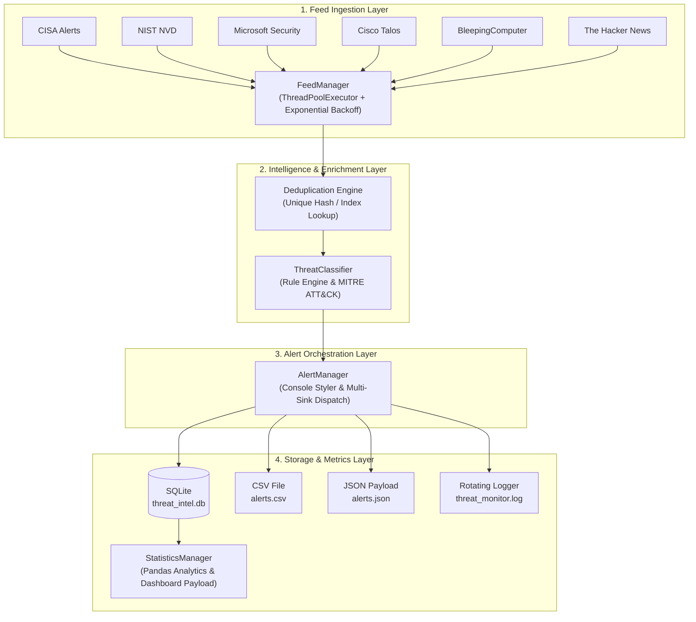

# 🛡️ ThreatTracker: Production SOC Threat Intelligence RSS Monitoring Engine

[](https://www.python.org/)
[](LICENSE)
[](#architecture)
[](https://attack.mitre.org/)

A high-performance, resilient, production-grade Threat Intelligence pipeline built for Security Operations Centers (SOC) and Cyber Threat Intelligence (CTI) analysts. It concurrently ingests advisories from premier security sources, eliminates duplicate entries, performs automated threat classification, maps findings to **MITRE ATT&CK** techniques, evaluates triage severity, and synchronizes data into multiple analytical sinks (SQLite, CSV, and JSON).

---

## 🌟 Key Features

- **Concurrent Multi-Feed Ingestion:** Simultaneously queries leading cybersecurity feeds using a threaded worker pool with exponential backoff retry mechanisms.
- **Deduplication Engine:** Generates deterministic SHA-256 hashes from feed GUIDs, titles, and URLs to ensure zero duplicate alerts.
- **Rule-Based Threat Categorization:** Automatically classifies threats into 10 key categories:
  - `Ransomware`, `Malware`, `Phishing`, `Vulnerability`, `Data Breach`, `APT`, `Botnet`, `Cryptomining`, `DDoS`, and `Other`.
- **Context-Aware Severity Scoring:** Evaluates indicators (e.g., *active exploitation, unauthenticated RCE, CVSS scores, zero-day vulnerabilities*) to assign SOC-standard severities:
  - `Critical`, `High`, `Medium`, `Low`.
- **MITRE ATT&CK Mapping:** Identifies tactic/technique fingerprints (e.g., `T1566 - Phishing`, `T1486 - Data Encrypted for Impact`, `T1190 - Exploit Public-Facing Application`).
- **Multi-Sink Persistence:**
  - 🗄️ **SQLite (`threat_intel.db`)**: Indexed schema for rapid querying and historical search.
  - 📊 **CSV (`alerts.csv`)**: Flat-file audit log and spreadsheet analysis.
  - 🌐 **JSON (`alerts.json`)**: Dashboard and SIEM-ready structured payloads.
- **Real-Time SOC Console Output:** ANSI-colored terminal alerts formatted specifically for SOC shift monitoring.
- **Enterprise Logging:** Rotating file logs (`threat_monitor.log`) with a 10MB threshold and automated backup rotation.

---

## 📡 Default Threat Feeds

| Source | Description | URL |
|---|---|---|
| **CISA Alerts** | US Cybersecurity and Infrastructure Security Agency advisories | [cisa.gov](https://www.cisa.gov/cybersecurity-advisories/all.xml) |
| **NIST NVD** | National Vulnerability Database CVE updates | [nvd.nist.gov](https://nvd.nist.gov/feeds/xml/cve/misc/nvd-rss.xml) |
| **Microsoft Security** | Microsoft Security Response Center (MSRC) intelligence | [microsoft.com](https://www.microsoft.com/en-us/security/blog/feed/) |
| **Cisco Talos** | World-class threat research, APT campaigns & zero-days | [talosintelligence.com](https://blog.talosintelligence.com/rss/) |
| **BleepingComputer** | Fast-breaking ransomware, breaches & security news | [bleepingcomputer.com](https://www.bleepingcomputer.com/feed/) |
| **The Hacker News** | Broad infosec vulnerabilities, exploits & cyber attacks | [thehackernews.com](https://feeds.feedburner.com/TheHackersNews) |

---

## 🏗️ Architecture



---

## 🚀 Quick Start

### 1. Prerequisites
- Python **3.12+**
- `pip` package manager

### 2. Installation
Clone the repository or navigate to the project directory, then install the dependencies:

```bash
pip install feedparser pandas colorama
```

---

## 💻 Usage

### Continuous Monitoring (Default: 5-minute interval)
Runs 24/7 in the background with graceful shutdown on `Ctrl+C`:
```bash
python threat_monitor.py
```

### Single Execution Sweep (`--once`)
Executes an immediate one-off sweep across all feeds, saves newly discovered threats, prints statistics, and exits:
```bash
python threat_monitor.py --once
```

### Custom Polling Interval
Change the check interval (e.g., poll every 60 seconds):
```bash
python threat_monitor.py --interval 60
```

### View Database Statistics Only (`--stats`)
Renders current metrics from `threat_intel.db` without initiating web requests:
```bash
python threat_monitor.py --stats
```

### Full CLI Options
```text
options:
  -h, --help           show this help message and exit
  --interval INTERVAL  Polling interval in seconds between checks (default: 300)
  --db DB              Path to SQLite database file (default: threat_intel.db)
  --csv CSV            Path to CSV export file (default: alerts.csv)
  --json JSON          Path to JSON export file (default: alerts.json)
  --log LOG            Path to rotating log file (default: threat_monitor.log)
  --once               Run a single collection sweep and exit immediately
  --stats              Render current statistics from existing database and exit
```

---

## 🖥️ SOC Alert Output Format

Every ingested threat prints a standardized SOC terminal block:

```text
--------------------------------------------------------------------------------
[2026-10-30T14:32:00+00:00]
Source:   Cisco Talos
Category: Vulnerability
Severity: Critical
Headline: Two critical RCEs in PHP core actively exploited
Link:     https://blog.talosintelligence.com/two-critical-rces-in-php-core/
MITRE:    T1190 - Exploit Public-Facing Application
--------------------------------------------------------------------------------
```

---

## 📊 Summary Statistics & Metrics

At the end of every cycle (or via `--stats`), an operational summary is generated:

```text
================================================================================
                 SOC THREAT INTELLIGENCE SUMMARY STATISTICS
================================================================================
Total Ingested Alerts: 90

[+] Severity Distribution:
  • Critical  :    10 ( 11.1%)
  • High      :    10 ( 11.1%)
  • Medium    :    36 ( 40.0%)
  • Low       :    34 ( 37.8%)

[+] Threat Category Breakdown:
  • Vulnerability  :    30 ( 33.3%)
  • Phishing       :     9 ( 10.0%)
  • Malware        :     9 ( 10.0%)
  • APT            :     4 (  4.4%)
  • Ransomware     :     2 (  2.2%)
  • Data Breach    :     1 (  1.1%)
  • Other          :    35 ( 38.9%)

[+] Ingestion By Feed Source:
  • The Hacker News          :    50 ( 55.6%)
  • Cisco Talos              :    15 ( 16.7%)
  • BleepingComputer         :    15 ( 16.7%)
  • Microsoft Security Blog  :    10 ( 11.1%)
================================================================================
```

---

## 📦 Generated Output Files

| File | Purpose |
|---|---|
| [`threat_intel.db`](file:///c:/Users/DELL/Music/ThreatTracker.py/threat_intel.db) | Primary SQLite database with indexed lookups (`alert_id`, `category`, `severity`, `source`). |
| [`alerts.csv`](file:///c:/Users/DELL/Music/ThreatTracker.py/alerts.csv) | Comma-separated values file for Excel, Splunk forwarders, or manual review. |
| [`alerts.json`](file:///c:/Users/DELL/Music/ThreatTracker.py/alerts.json) | Formatted JSON array containing all indexed alerts for dashboards and web integrations. |
| [`threat_monitor.log`](file:///c:/Users/DELL/Music/ThreatTracker.py/threat_monitor.log) | Structured operational log with timestamp, log level, thread name, and tracebacks. |

---

## 🔒 Security & Best Practices

- **Sanitization:** All HTML tags and entities are stripped and sanitized before database insertion to prevent persistent XSS or database injection.
- **Fail-Safe Networking:** Feeds timeout after 15 seconds to prevent hung threads; failures trigger exponential backoff.
- **Signal Handling:** Listens for `SIGINT` (`Ctrl+C`) and `SIGTERM` to safely close database transactions and terminate worker threads.

---

## 📄 License
Released under the [MIT License](LICENSE).
Developed by
George Botros Azer

Junior SOC Analyst | SIEM | Log Analysis | Threat Detection | Threat Intelligence
